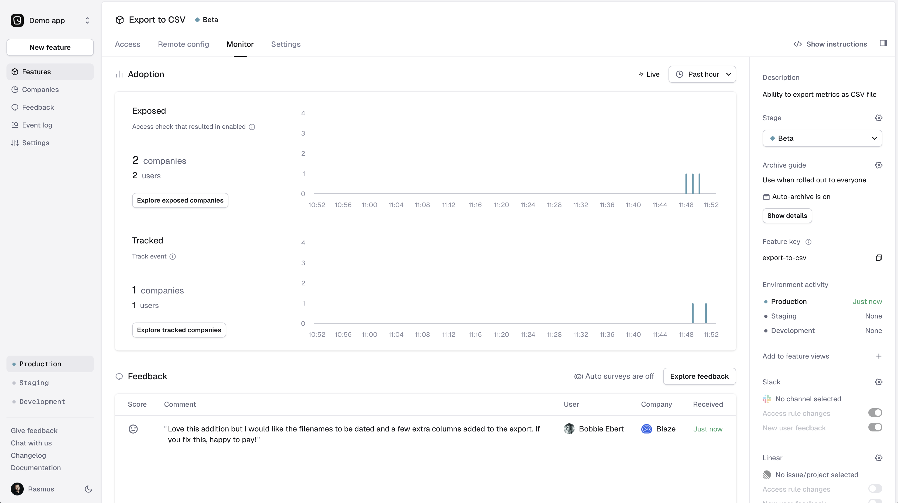

# Launch monitor

Use the launch monitor to track exposure and adoption, and to collect end-user feedback.

<figure><figcaption></figcaption></figure>

## Exposure

The Exposed chart counts companies exposed to the feature. For Boolean flags, exposure means the SDK selected `true`. For Multivariate flags, selecting any variant counts as exposure, even if its value is `false`, `0` or `null`.

## Adoption

The Tracked chart shows the distinct count of companies that have interacted with the flagged workflow. Interactions are tracked with the `track` method.

```tsx
import { useFlag, useTrack } from "@reflag/react-sdk";

function StartHuddleButton() {
  const enabled = useFlag("huddle");
  const track = useTrack();

  if (!enabled) {
    return null;
  }

  return (
    <div>
      Huddles
      <button onClick={() => track("Started huddle")}>Start huddle</button>
    </div>
  );
}
```

## Feedback

You can collect end-user feedback on new flag rollouts to catch and fix issues faster.

### Static feedback button

Configure the flag's adoption rules to match the event name you track. Reading a flag records a check automatically; call `track()` when someone actually uses the feature.

Here's a brief example using the [Reflag React SDK](../../supported-languages/react-sdk/README.md) to collect feedback:

```tsx
import { useFlag, useRequestFeedback } from "@reflag/react-sdk";

function StartHuddleButton() {
  const enabled = useFlag("my-flag");
  const requestFeedback = useRequestFeedback();

  if (!enabled) {
    return null;
  }

  return (
    <>
      <button>Use huddle</button>
      <button
        onClick={() => requestFeedback({ flagKey: "my-flag", title: "How do you like huddles?" })}
      >
        Give feedback!
      </button>
    </>
  );
}
```

### Automated feedback survey

Automated surveys let you ask for feedback at the right time after `N` interactions with the flag. [Learn more here](automated-feedback-surveys.md).
